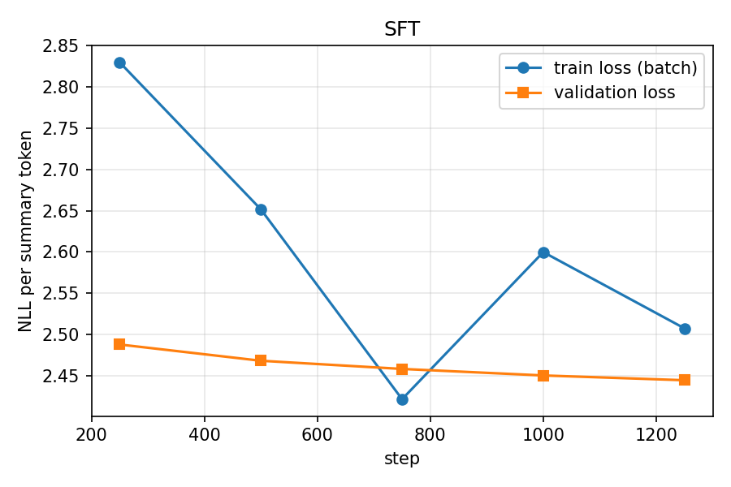
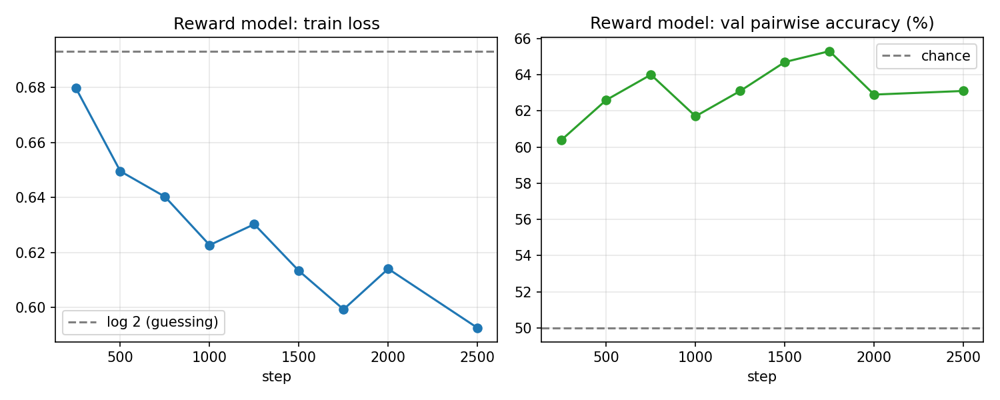
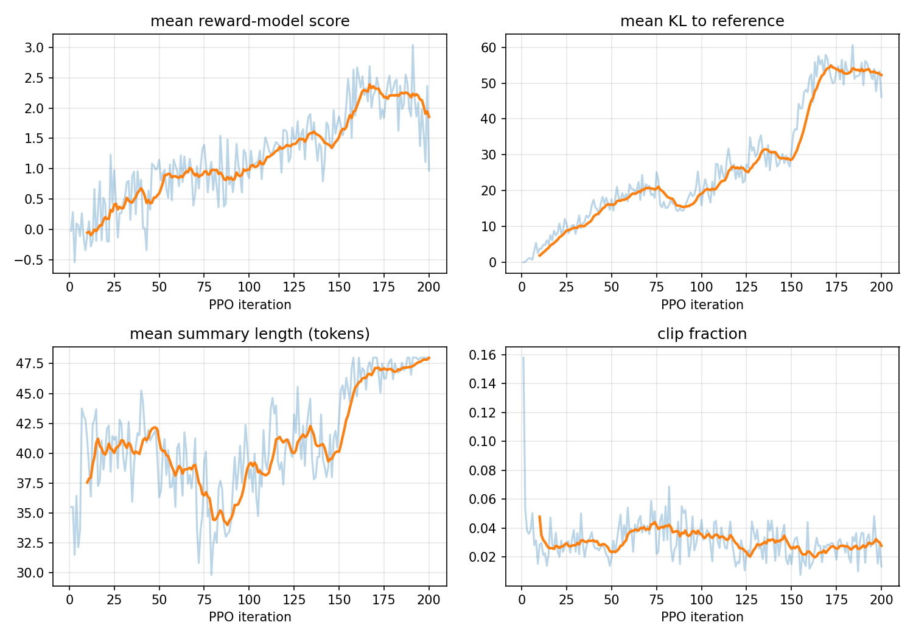
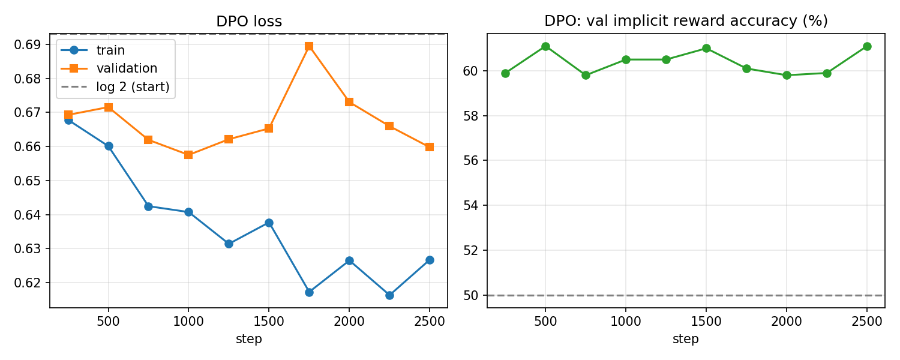
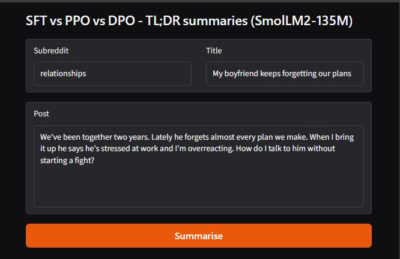
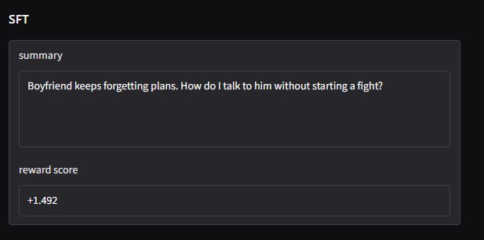
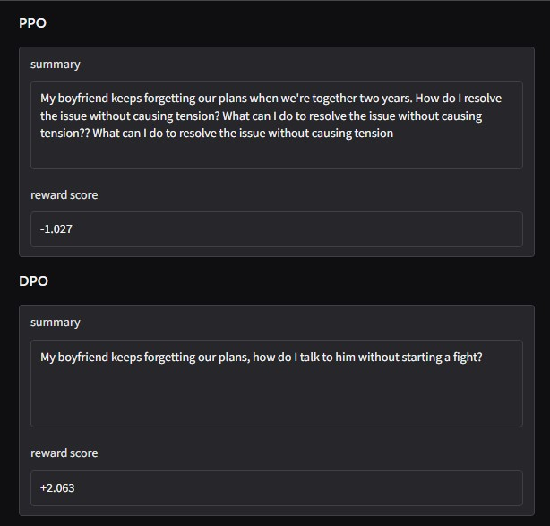

# Learning to Summarize from Human Feedback — from scratch

We took a tiny language model (**SmolLM2-135M**) and taught it to write one-line
TL;DRs of Reddit posts, then aligned it with human preferences in the same four
stages as Stiennon et al. (2020):

| Stage | What we train | What it learns |
|---|---|---|
| 1. SFT | the policy | copy human-written summaries |
| 2. Reward model | a "judge" r_φ(x, y) | score a summary like a human would |
| 3. PPO | the policy (+ value head) | write summaries the judge likes, without drifting far from SFT |
| 4. DPO | the policy | the same goal, straight from the preference pairs, with no judge |

Every loss (SFT, Bradley–Terry, PPO, DPO) is written by hand in PyTorch. We only use
`AutoTokenizer`, `AutoModelForCausalLM` and `model.generate` from `transformers`. No
`trl`, `peft`, `Trainer` or anything else that does RLHF for you.

**Checkpoints:** https://drive.google.com/drive/folders/1pseQqnIXHZGRTvCz-w6zwg-Ria0fD98C  
**Blog:** https://medium.com/@amamamukhtar17/we-rebuilt-the-rlhf-recipe-behind-chatgpt-on-a-135m-model-and-a-free-gpu-7cbf104e3d3e  
**LinkedIn:** https://www.linkedin.com/posts/amama-mukhtar_we-rebuilt-the-rlhf-recipe-behind-chatgpt-activity-7526975327491907585-cnFF  
**Team:** Amama Mukhtar · Zeenat Ijaz


---

## Repository layout

```
starter/            the given starter files, unchanged
common.py           token_logprobs, summary_mask, generation helper (used by every stage)
task1_data.py       Task 1: data stats + summary-mask check
train_sft.py        Task 2: supervised fine-tuning
train_reward.py     Task 3: reward model class + Bradley–Terry training
train_ppo.py        Task 4: value head, rollout, per-token rewards, returns, PPO loss
train_dpo.py        Task 5: DPO
evaluate.py         Task 6: SFT vs PPO vs DPO on 300 held-out posts
human_eval.py       Section 3.2: blind 30-post sheet + Table 4
plots.py            all figures
results/            logs, tables, figures, summaries, human eval, analysis.md
app/app.py          Gradio front end
A3_RLHF_Summarization.ipynb   the whole pipeline in one notebook, with outputs
colab_run.ipynb     one-click run on Colab
```

## How to run

On Colab or Kaggle with a T4 GPU (open `colab_run.ipynb`, or):

```bash
pip install -r requirements.txt
bash run_all.sh
```

or stage by stage, in this order (each stage needs the checkpoint from the one before):

```bash
python starter/check_starter.py
python task1_data.py
python train_sft.py
python train_reward.py
python train_ppo.py
python train_dpo.py
python evaluate.py
python plots.py
python human_eval.py make     # both members fill results/human_eval.csv
python human_eval.py score
python app/app.py             # front end
```

Every training script takes `--max_steps` (PPO: `--iterations`) for a quick smoke test.
If the GPU runs out of memory, lower `--micro_batch` (SFT, DPO) or raise `--chunks` (PPO):
gradients are accumulated, so the effective batch size and all required settings stay the same.

To use downloaded checkpoints, put them in `checkpoints/{sft,reward,ppo,dpo}` or set `CKPT_DIR`.

## Hyper-parameters (exactly as the manual)

| Stage | Settings |
|---|---|
| SFT | 1 epoch, 20k pairs, AdamW lr 5e-5, batch 16, grad clip 1.0 |
| Reward | 1 epoch, 20k pairs, AdamW lr 1e-5, batch 8 pairs |
| PPO | 200 iterations × 16 prompts, K=4, ε=0.2, β_KL=0.05, c_V=0.1, c_H=0.01, γ=1, AdamW lr 1e-5, clip 1.0 |
| DPO | 1 epoch, 20k pairs, β=0.1, AdamW lr 2e-6, batch 8 pairs |

## Results

### Table 1 – Data
| Item | Value |
|---|---|
| SFT train / validation pairs | 20000 / 500 |
| Preference train / validation pairs | 20000 / 1000 |
| Evaluation posts | 300 |
| Mean / max prompt length, SFT train (tokens) | 317.4 / 448 |
| Mean / max summary length, SFT train (tokens, incl. EOS) | 33.8 / 48 |

### Table 2 – Training
| Stage | Final train loss | Validation metric | Time / GPU |
|---|---|---|---|
| SFT | 2.508 | val. loss: **2.445** | 71 min / Tesla T4 |
| Reward model | 0.593 | pairwise acc.: **63.1%** | 103 min / Tesla T4 |
| PPO | 0.136 | final mean r_φ: **0.97** (last iteration, 16 prompts; 10-iteration average ≈ 1.85) | 50 min / Tesla T4 |
| DPO | 0.627 | implicit reward acc.: **61.1%** | 186 min / Tesla T4 |

### Table 3 – SFT vs PPO vs DPO (300 held-out posts, greedy decoding)
| Policy | Mean r_φ | Win rate vs SFT | KL to SFT | Length | ROUGE-L |
|---|---|---|---|---|---|
| SFT | -0.475 | – | 0.000 | 29.7 | **0.253** |
| PPO | 0.208 | 67.3% | 12.566 | 46.3 | 0.200 |
| DPO | **0.438** | **70.7%** | 2.704 | 44.0 | 0.237 |

### Table 4 – Human evaluation (30 posts, blind A/B/C, order shuffled)
| | SFT picked | PPO picked | DPO picked |
|---|---|---|---|
| Amama | 16 | 1 | 13 |
| Zeenat (round 2) | 7 | 7 | 16 |
| **Total (60 votes)** | **23** | **8** | **29** |

Agreement between us: **19 / 30 (63%)** (chance is about 33%).

Round 1 (Zeenat): SFT 10, PPO 9, DPO 11; agreement 11 / 30 (37%).

**Why two rounds.** In round 1 Zeenat's sheet showed Amama's picks and Zeenat never picked B, so Zeenat repeated the
picks on a clean, reshuffled sheet (positions A/B/C = 10/12/8). The decision to repeat was made after seeing the round 1
result, and Zeenat had already seen the posts; Zeenat chose the same model in both rounds on 17 / 30 posts. Amama was not
repeated (positions 19/7/4). With 30 posts, treat this as a small, noisy check. In `human_eval.csv`, Zeenat's round 2
picks are translated to the original letters.

| SFT | Reward model |
|---|---|
|  |  |

| PPO | DPO |
|---|---|
|  |  |

### What we saw
- The reward model is clearly above chance (63% vs 50%), well short of the paper's large models, as expected for 135M parameters and 20k pairs.
- PPO raised the reward-model score, but by the end every summary hit the 48-token limit and the KL to SFT reached 46–53 nats. On the 300 eval posts its ROUGE-L fell from 0.253 to 0.200. This is consistent with reward hacking, with the reward model favouring longer summaries.
- PPO got the fewest human votes (8/60), although the reward model scores it above SFT. DPO got the most (29), SFT 23. The sample is small, so this suggests rather than proves that a higher r_φ is not a better summary.
- DPO got the highest r_φ and win rate (70.7%) while staying much closer to SFT (KL 2.7 vs 12.6 for PPO).
- DPO's implicit reward accuracy (61%) is close to the reward model's (63%) on the same 1000 pairs, with no reward model, no sampling and only two models in memory.

Full analysis: `results/analysis.md`

## Front end

| Input | SFT | PPO and DPO |
|---|---|---|
|  |  |  |

On this post: SFT +1.492, PPO -1.027, DPO +2.063. One example, not an average.

## Correctness checks (Section 3.3)

All passed on our run:

```
SFT mask check        : row 0..3 match=True (decoded = summary + <|endoftext|>)
frozen check          : reference all frozen = True, reward model all frozen = True
PPO iteration 1       : mean KL to reference = 0.000000
PPO epoch 1 (every it): max |ratio-1| = 1.4e-04 over all iterations, clip fraction = 0.000
DPO first step loss   : 0.6931 (log 2 = 0.6931)
```

| Check | Where the output is | Expected |
|---|---|---|
| SFT mask decodes to exactly summary + EOS | `results/check_summary_mask.txt` | `match=True` on every row |
| π_ref and r_φ fully frozen | first line of `results/check_ppo.txt`, `results/check_dpo.txt` | `True` |
| PPO iteration 1 KL = 0 | `results/check_ppo.txt` | `0.000000` |
| PPO epoch 1 of every iteration: ratio = 1, clip fraction = 0 | `results/check_ppo.txt`, `epoch0_*` columns of `ppo_log.jsonl` | ~1e-6, 0.000 |
| DPO first-step loss = log 2 | `results/check_dpo.txt` | 0.6931 |
| Padding: left-padded prompts, reward read at last *real* token via `attention_mask` | `common.py`, `train_reward.py` (`RewardModel.forward`) | — |
