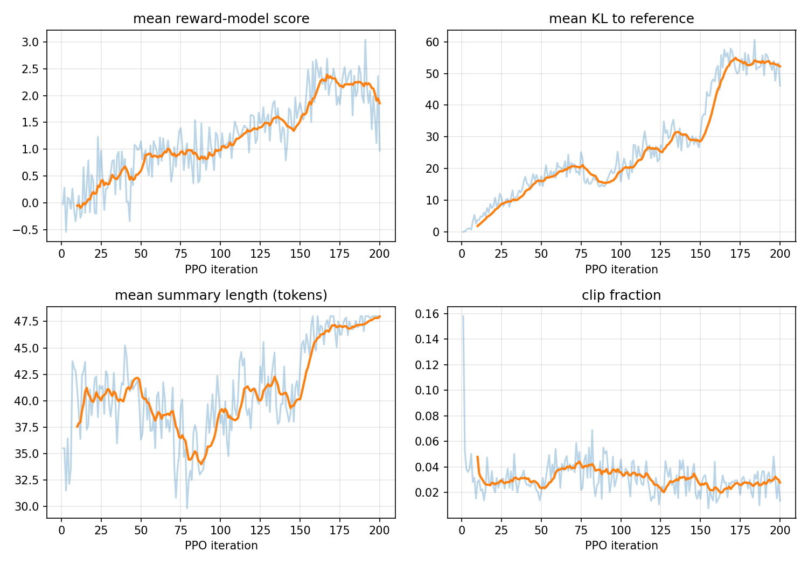

# Task 7 – Analysis

## 7.1 How accurate is the reward model, and what does it get wrong?

Validation pairwise accuracy: **63.1%** on 1,000 pairs (chance = 50%).

`results/reward_val_scores.jsonl` holds every validation pair with both scores. Sort by
`margin` and read the most negative ones. Three examples it gets wrong:

1. Chosen: "I don't have good friends and I'm losing my mind..." vs rejected: "[30F] Cut family out of life and have strained
   relationship with siblings..." (margin -4.33). *Why:* the rejected one is closer to the post (family cut off, siblings, no support). The chosen one
   claims lifelong depression, which the post never says. This looks like a noisy human label more than a judge mistake.
2. Chosen: "My hater grandparents are getting old; my Mom is now demanding..." vs rejected: "Over the years my family has been
   incredibly cruel towards my homophobic grandfather..." (margin -3.59). *Why:* the rejected one turns the story around (the
   grandparents were the cruel ones). It's a factual error the judge did not notice.
3. Chosen: "TIFU by thinking I was being pranked." vs rejected: "drunk asshole broke into my house, knocked over my kitchen
   table..." (margin -3.56). *Why:* the rejected one is much longer, and it adds "Told the cops I was drunk", which is false:
   the post only says the officer asked if they had been drinking. The judge preferred length and detail.

Length: when the two summaries differ in word count, the reward model scores the longer one higher in 67% of pairs, while
humans chose the longer one in 61%. So the judge leans towards longer text a little more than the humans did. Other
wrong pairs are plausible near-ties.

## 7.2 PPO training curves

- Mean r_φ went from about 0 to a 10-iteration average of about 1.85 (it peaked near 2.3 around iterations 160-190).
- Mean KL grew from 0 to about 52 nats, with a sharp jump from about 30 to 50 near iterations 150-165.
- Mean length went from about 35 to 48 tokens, the limit.
- **Is a higher r_φ the same as a better summary?** No, not necessarily. On 300 posts PPO raised r_φ from -0.475 to
  0.208, but ROUGE-L fell from 0.253 to 0.200. In our human eval PPO got 8/60 votes (1 and 7 of 30), vs SFT 23 and DPO 29.
  The reward model is an imperfect judge (63.1%). Rising score with falling ROUGE-L, longer text and repetition is
  consistent with reward hacking (Goodhart's law). The human sample is small and was repeated for one member (see Table 4).

## 7.3 What does β_KL do? What if β_KL = 0?

Eq. 41 maximises `E[r_φ(x,y)] − β·KL(π_θ || π_ref)`. In our per-token reward every token
pays `−β(log π_old − log π_ref)`, so moving away from SFT costs reward.

β_KL is a leash. It keeps the policy close to the SFT model, where (a) the text is still
fluent and (b) the reward model is still accurate, because it was trained on summaries that
look like SFT's.

With β_KL = 0 the only signal left is r_φ. I'd expect the score to rise faster and higher, the KL to
grow further, and the policy to find whatever the reward model over-rates: very long
or very short outputs, repeated phrases, odd tokens, the same generic template for every post.
The policy may collapse to a few templates, and human-judged quality would drop even while r_φ goes
up. That's classic reward hacking.

## 7.4 Clip fraction

Epoch 1 of every iteration: clip fraction exactly 0 (ratio = 1, policy = old policy).
Averaged over the 4 epochs it was 0.031 on average (max 0.158, at iteration 1).

So only a small share of tokens had their probability changed by more than ±20%, which means
each update is small and controlled, and that's the point of the clip. If it were large (>0.3) the
learning rate or K would be too big. If it stayed ~0 forever the policy would barely be learning.

## 7.5 Where did DPO's reward go?

- Eq. 55: the optimal policy for the KL-constrained objective is
  `π*(y|x) = π_ref(y|x) · exp(r(x,y)/β) / Z(x)`.
- Eq. 56–57: solve it for r: `r(x,y) = β log(π*(y|x)/π_ref(y|x)) + β log Z(x)`.
  So **the reward is hidden inside the policy itself**. Any policy defines an implicit reward
  `β log(π_θ/π_ref)`.
- Eq. 58: plug that into Bradley–Terry. It only uses the *difference* `r(x,y_w) − r(x,y_l)`.
  Both summaries share the same prompt x, so `β log Z(x)` appears twice and cancels. That's why
  we never need Z(x), which would be a sum over every possible summary and can't be computed.

Accuracy on the same 1,000 validation pairs: DPO implicit reward 61.1% vs reward model 63.1%.
The two are close. DPO's learning rate is tiny (2e-6) and its implicit reward starts at 0, which may explain the small gap.

## 7.6 Cost and choice

| | PPO | DPO |
|---|---|---|
| Models in GPU memory | 3 transformers (policy + value head, frozen reference, frozen reward model), and the reward model had to be trained first | 2 (policy, frozen reference) |
| Time | 50 min (+ 103 min for the reward model) | 186 min |
| Generation during training | yes (slow, 48 sampled tokens × 16 every iteration) | no |
| Hyper-parameters | many (ε, β, c_V, c_H, K, γ) | one (β) |

**Our choice for a new project:** DPO, because it's simpler, needs fewer models and has
fewer moving parts. Here it got the best r_φ, the best win rate (70.7%) and the most human votes, with a much smaller KL
(2.7 vs 12.6). It wasn't faster in our run: 186 min vs 153 min for reward model + PPO. SFT keeps the best ROUGE-L. PPO is worth it when you need
on-policy exploration, a reusable reward model (e.g. to score many new outputs, or for
best-of-n), or a reward that isn't a pairwise preference (tests passing, a math checker).
